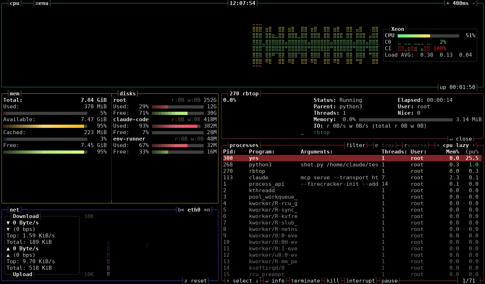
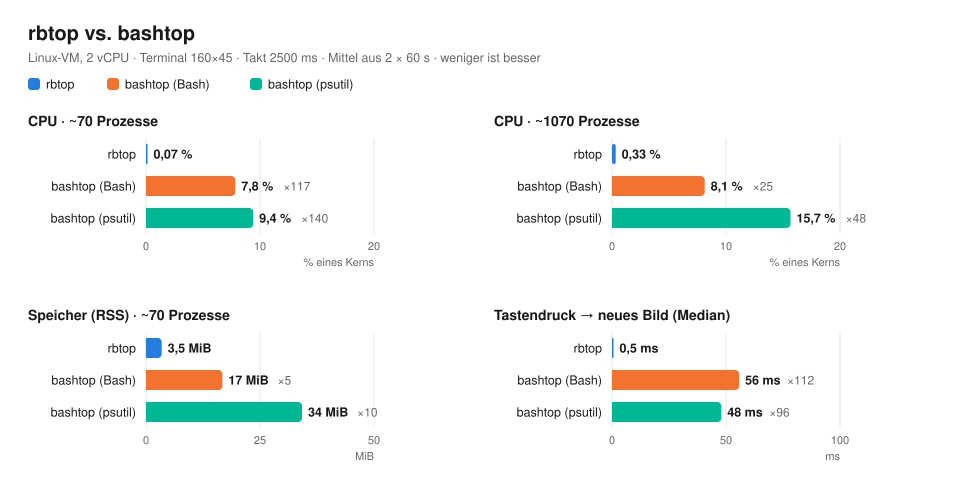

# rbtop – bashtop in Rust

[](https://github.com/gbomacfly/rbtop/actions/workflows/ci.yml)
[](https://crates.io/crates/rbtop)
[](LICENSE)

[English](README.md) · **Deutsch**

Ein Nachbau von [bashtop](https://github.com/aristocratos/bashtop) (aristocratos) in Rust:
gleiches Layout, **gleiche Tastenbelegung**, gleiches Config- und Theme-Format, aber ein
Bruchteil der CPU-Last. Dazu kommen die umsetzbaren Feature-Requests aus den GitHub-Issues
des Originals.

> [!WARNING]
> **Komplett „vibe-gecoded“.** Der gesamte Code, die Tests und diese README wurden von
> einer KI (Claude, Anthropic) geschrieben. Gebaut und getestet wurde automatisiert in
> einer Sandbox und anschließend auf echten Systemen, aber **kein Mensch hat den Code
> Zeile für Zeile reviewt**. rbtop läuft meist als root und kann Signale an beliebige
> Prozesse schicken (`t`/`k`/`i`/`p`), also mit entsprechender Vorsicht benutzen.
> Benutzung auf eigene Gefahr, siehe [LICENSE](LICENSE). Bugs und Reviews sind als Issue
> willkommen.



Abhängigkeiten: nur das `libc`-Crate. Kein TUI-Framework, kein psutil, keine
externen Programme pro Tick.

## Installation

**Homebrew** (macOS und Linux, fertig gebaut):

```sh
brew install gbomacfly/tap/rbtop
brew upgrade rbtop                # spätere Updates
```

**Debian, Ubuntu, Proxmox VE** (`.deb` mit dem statischen Build, amd64 und arm64):

```sh
v=$(curl -fsSLo /dev/null -w '%{url_effective}' https://github.com/gbomacfly/rbtop/releases/latest); v=${v##*/v}
arch=$(dpkg --print-architecture)
curl -fsSLO https://github.com/gbomacfly/rbtop/releases/download/v$v/rbtop_${v}-1_${arch}.deb
sudo apt install ./rbtop_${v}-1_${arch}.deb
```

Die erste Zeile ermittelt die neueste Version. Das Paket installiert `/usr/bin/rbtop` und
die Themes nach `/usr/share/rbtop/themes`; es hat keine Abhängigkeiten und läuft deshalb
auch auf älteren Releases.

**Cargo:**

```sh
cargo binstall rbtop              # fertiges Binary, braucht cargo-binstall
cargo install --locked rbtop      # aus dem Quellcode, Rust ≥ 1.77
```

**Release-Archive** zu jedem Tag `v*` auf der [Release-Seite](https://github.com/gbomacfly/rbtop/releases):

- Linux: x86_64 und aarch64, jeweils glibc und statisch mit musl
- macOS: `aarch64-apple-darwin` (Apple Silicon), `x86_64-apple-darwin` (Intel) und
  `universal-apple-darwin` (beides in einer Datei)

Zu jedem Archiv und `.deb` gibt es eine `.sha256`-Datei, damit lässt sich der Download
prüfen, z. B.:

```sh
shasum -a 256 -c rbtop-v0.3.4-x86_64-unknown-linux-musl.tar.gz.sha256
```

## Speed

Benchmark vom 28.11.2026: rbtop 0.3.1 gegen bashtop 0.9.25, beide bashtop-Modi
(psutil = Standard, wenn psutil installiert ist; reines Bash). Gleiche Bedingungen
für alle: Linux-VM mit 2 vCPUs (x86_64), Terminal 160×45, Takt 2500 ms, je zwei
Läufe à 60 s nach 6 s Einschwingzeit.

<picture>
  <source media="(prefers-color-scheme: dark)" srcset="docs/bench-de-dark.svg">
  
</picture>

**~70 Prozesse (normaler Server-Leerlauf):**

| | rbtop | bashtop Bash | bashtop psutil |
|---|---|---|---|
| CPU (% eines Kerns) | **0,07 %** | 7,8 % (×117) | 9,4 % (×140) |
| Speicher (RSS) | **3,5 MiB** | 16,8 MiB (×5) | 34,2 MiB (×10) |
| Start bis erstes Bild | **0,11 s** | 1,24 s | 1,50 s |
| Reaktion auf Taste (Median / max) | **0,5 / 1,2 ms** | 56 / 76 ms | 48 / 77 ms |
| Gestartete Hilfsprozesse | **0/s** | 24/s | 22/s |
| Terminal-Ausgabe | **0,6 KiB/s** | 3,6 KiB/s | 4,1 KiB/s |

**~1070 Prozesse:**

| | rbtop | bashtop Bash | bashtop psutil |
|---|---|---|---|
| CPU (% eines Kerns) | **0,33 %** | 8,1 % (×25) | 15,7 % (×48) |
| Speicher (RSS) | **3,6 MiB** | 17,5 MiB | 37,0 MiB |
| Start bis erstes Bild | **0,27 s** | 1,17 s | 1,86 s |
| Reaktion auf Taste (Median / max) | **0,6 / 3,4 ms** | 38 / 135 ms | 38 / 274 ms |

Gemessen wurde:

- **CPU:** User- plus System-Zeit des ganzen Prozessbaums, einschließlich der
  kurzlebigen Hilfsprozesse, die bashtop startet (`ps`, `awk`, `grep` usw.).
- **Speicher:** mittlerer RSS-Wert des Prozessbaums über die Messdauer.
- **Hilfsprozesse:** neue Prozesse pro Sekunde laut `/proc/stat`. Der Leerlauf des
  Systems lag bei 0,08/s, rbtops gemessene 0,06/s sind also Rauschen.
- **Reaktion auf Taste:** Zeit vom Druck auf Pfeil runter bis zum ersten neu
  gezeichneten Byte, Median und Maximum aus 15 Tastendrücken.
- **Startzeit:** vom Programmstart bis zum ersten vollständigen Bild. Bei rbtop sind
  darin absichtlich 100 ms für die erste CPU-Messung enthalten.

Unter Last holt bashtops Bash-Modus auf, weil er pro Tick einmal das in C geschriebene
`ps` aufruft. Bei rbtop steigen die Kosten mit jedem Prozess, weil der Kernel jede
`/proc/<pid>/stat`-Datei einzeln erzeugen muss. Der psutil-Modus wird bei vielen
Prozessen am langsamsten, weil er alle Prozesse in Python durchläuft.

Die Messung lässt sich mit [`bench/bench.py`](bench/bench.py) wiederholen; die
Rohdaten liegen in [`bench/results-2026-11-28.jsonl`](bench/results-2026-11-28.jsonl).

```sh
python3 bench/bench.py rbtop 60 -- ./target/release/rbtop
python3 bench/bench.py bashtop 60 -- bash /pfad/zu/bashtop
python3 bench/spawn_load.py 1000    # 1000 Last-Prozesse (sleep 3600)
python3 bench/plot.py bench/results-2026-11-28.jsonl   # Grafik neu erzeugen
```

Warum es so schnell ist:

- **Diff-Renderer:** zwei Zellpuffer; geschrieben werden nur geänderte Zellen, mit
  minimalen Cursor-Sprüngen und SGR-Wechseln, alles in *einem* `write()` mit Synchronized
  Output (`?2026`).
- **Prozess-Hot-Path:** pro Tick wird pro Prozess nur `/proc/<pid>/stat` gelesen, via
  `openat()` relativ zu einem offenen `/proc`-Handle in einen wiederverwendeten Puffer.
  `cmdline`, UID und cgroup werden nur einmal pro neuer PID gelesen (bzw. nach `exec`).
- **Kein Polling:** `select()` schläft bis zum nächsten Tick, zur nächsten Sekunde (Uhr)
  oder bis zum nächsten Tastendruck; Eingaben werden sofort gezeichnet.
- **nvidia-smi** läuft, wenn vorhanden, *einmal* dauerhaft im Streaming-Modus (`-lms`),
  statt jeden Tick neu gestartet zu werden.
- Release-Profil: LTO, `codegen-units=1`, `panic=abort`, gestrippt (ca. 750–850 KB).

Mit `rbtop -d` siehst du die Zeiten für Sammeln/Zeichnen live am unteren Rand der CPU-Box.

## Tasten (wie im Original)

| Taste | Funktion |
|---|---|
| Esc, M, m | Hauptmenü |
| F2, O, o | Optionen |
| F1, H, h | Hilfe |
| Ctrl-C, Q, q | Beenden |
| +, A, a / -, S, s | Update-Timer ±100 ms |
| Up / Down (Tab) | Auswahl in der Prozessliste |
| Enter | Detailansicht des ausgewählten Prozesses (nochmal: schließen) |
| Pg Up / Pg Down | Eine Seite springen |
| Home / End | Erste / letzte Seite |
| Left / Right | Vorherige / nächste Sortierung |
| b, B / n, N | Vorheriges / nächstes Netzwerkgerät |
| E, e | Baumansicht umschalten |
| R, r | Sortierung umkehren |
| F, f | Filter eingeben (Enter übernimmt, Esc verwirft) |
| C, c | Filter löschen |
| T, t | SIGTERM an ausgewählten Prozess |
| K, k | SIGKILL an ausgewählten Prozess |
| I, i | SIGINT an ausgewählten Prozess |

**Neu** (alle Tasten waren im Original frei):

| Taste | Funktion |
|---|---|
| P, p | Pause/Fortsetzen: SIGSTOP bzw. SIGCONT, je nach aktuellem Status (#185) |
| Z, z | Download/Upload-Summen zurücksetzen (#63) |
| Ctrl-Z | rbtop in den Hintergrund (`fg` holt es zurück) |
| Maus | Scrollen und Klicken in der Prozessliste (Klick auf ausgewählte Zeile = Details), alle `┤…├`-Buttons sind klickbar |
| Maus auf Spaltenkopf | Nach dieser Spalte sortieren, erneuter Klick kehrt die Reihenfolge um (bei Cpu% bleibt lazy/responsive erhalten) |

Im Signal-Dialog gibt es zusätzlich **[ +Tree ]**: schickt das Signal an den Prozess und
alle seine Nachfahren (Wunsch aus #185, z. B. Blender-Renderjobs pausieren).

## Feature-Requests aus den bashtop-Issues

| Issue | Wunsch | Status in rbtop |
|---|---|---|
| #17 | iotop-artige I/O-Werte | ✅ Lese-/Schreibraten pro Disk (`/proc/diskstats`, **ZFS-Datasets über kstat**), pro Prozess in der Detailansicht (`/proc/<pid>/io`) |
| #26, #221 | GPU-Auslastung | ✅ AMD über sysfs (`gpu_busy_percent`, VRAM, Temperatur), NVIDIA über *ein* dauerlaufendes `nvidia-smi` |
| #48 | zenpower/k10temp-Temperaturen | ✅ hwmon: coretemp (pro Kern), k10temp (Tdie/Tctl), zenpower, cpu_thermal (ARM), acpitz/x86_pkg_temp als Fallback |
| #63 | Netzwerk-Summen zurücksetzen | ✅ Taste `z` |
| #73 | Graphen statt Balken für Speicher | ✅ Option `mem_graphs` |
| #97 | Docker-Container-Infos | ✅ Container pro Prozess erkannt: Docker (inkl. Name), Podman, **Proxmox-LXC (`CT 101 (hostname)`) und -VMs (`VM 105 (name)`)**, libvirt, k8s; in der Detailansicht und im Filter suchbar |
| #119 | zram-Infos | ✅ zram-Geräte mit Original → komprimiert und Ratio in der Mem-Box |
| #185 | SIGSTOP/SIGCONT, auch für Kindprozesse | ✅ Taste `p`, Option „+Tree“ |
| #199 | Akkustand | ✅ in der CPU-Box-Titelleiste mit Lade-/Entladesymbol |
| – | Maussteuerung (in bpytop nachgereicht) | ✅ |
| #230 | Weitere Themes | ✅ lädt alle bashtop/bpytop/btop-`.theme`-Dateien unverändert, 9 Original-Themes liegen bei |
| #93 | Box mit eigenem Kommando (tail -f …) | ❌ nicht umgesetzt |
| #231 | Ausgabe auf freie VT umleiten | ❌ nicht nötig: `openvt -s -- rbtop` |
| #235 | Windows | ❌ (Linux und macOS, siehe unten) |

Nicht betroffen von Original-Bug #234 (Hänger bei `°C` in der sensors-Ausgabe), weil
rbtop die hwmon-Werte direkt aus `/sys` liest statt `sensors` zu parsen.

## Selbst bauen

Linux oder macOS, Rust ≥ 1.77:

```sh
cargo build --release          # → target/release/rbtop
sudo make install              # /usr/local/bin/rbtop + /usr/local/share/rbtop/themes
```

`make install PREFIX=…` funktioniert mit jedem Prefix; rbtop findet seine Themes dann in
`<prefix>/share/rbtop/themes`.

## macOS

Seit 0.2.0 läuft rbtop auch auf macOS, seit 0.3.0 mit Temperaturen, Disk-I/O, GPU und Akku, mit derselben Oberfläche, denselben Tasten und
derselben Config. Die Daten kommen aus den nativen Schnittstellen statt aus `/proc`:

| Bereich | Quelle unter macOS |
|---|---|
| CPU pro Kern, Load | Mach `host_processor_info`, `getloadavg` |
| Speicher, Swap | `host_statistics64` (Werte wie in der Aktivitätsanzeige), `vm.swapusage` |
| Prozesse | `libproc` (`proc_pidinfo`), Kommandozeile über `sysctl KERN_PROCARGS2` |
| Prozess-I/O (Detailansicht) | `proc_pid_rusage` |
| Netzwerk | `sysctl NET_RT_IFLIST2` (64-Bit-Zähler) |
| Disks | `getmntinfo`: `/` als `root` und externe Volumes (das Data-Volume teilt sich bei APFS den Container mit `/` und würde nur dieselben Zahlen wiederholen) |
| Disk-I/O | IOKit `IOBlockStorageDriver`-Statistiken; APFS-Volumes zeigen die Rate ihrer physischen SSD |
| CPU-/GPU-Temperatur | SMC (`Tp*`/`Te*` bzw. `Tg*` auf Apple Silicon, `TC0P` auf Intel), Fallback IOHID-Sensoren |
| GPU-Last | IOKit `IOAccelerator` „PerformanceStatistics“ |
| Akku | IOKit `AppleSmartBattery` (nur MacBooks) |

Die CPU-Temperatur ist der Mittelwert aller CPU-Sensoren, Werte pro Kern gibt es auf
dem Mac nicht. Bei Apple Silicon entfällt die VRAM-Angabe, weil GPU und CPU sich den
Speicher teilen. Container gibt es unter macOS nicht.

Hinweise:

- **`sudo rbtop`** zeigt CPU, Speicher und Threads aller Prozesse. Ohne root liefert macOS
  für Prozesse anderer Benutzer nur Name, Benutzer, Status und Startzeit; dort stehen
  CPU und Speicher dann auf 0.
- Das **Netzwerkgerät** beim Start ist das mit dem meisten Traffic (meist `en0`);
  wechseln wie gewohnt mit `b`/`n` oder fest über `net_device`.
- **Terminal:** rbtop nutzt 24-Bit-Farben. Mit iTerm2, Ghostty, WezTerm oder kitty
  passt alles. Wenn die Farben im Terminal.app von macOS falsch aussehen, liegt das
  an fehlender Truecolor-Unterstützung der installierten Version.
- Per **Browser** geladene Binaries markiert macOS als „aus dem Internet“; dann einmal
  `xattr -d com.apple.quarantine rbtop`. Mit `curl` geladene und die Homebrew-Installation
  sind nicht betroffen.

## Konfiguration

`~/.config/rbtop/rbtop.cfg`, Format wie bashtop (`key="value"`). Gibt es noch keine,
wird eine vorhandene `~/.config/bashtop/bashtop.cfg` übernommen. Alles ist auch im
Optionsmenü (`o`) änderbar und wird beim Schließen gespeichert.

Original-Optionen: `color_theme`, `update_ms`, `proc_sorting`, `proc_reversed`,
`proc_tree`, `check_temp`, `draw_clock`, `background_update`, `custom_cpu_name`,
`proc_gradient`, `proc_per_core`, `disks_filter` (zusätzlich mit `exclude=`-Präfix),
`hires_graphs`.

Neu: `mem_graphs`, `show_swap`, `show_battery`, `show_gpu`, `show_containers`,
`net_device`, `mouse`.

Themes werden gesucht in `~/.config/rbtop/themes`, den Theme-Ordnern von
bashtop/bpytop/btop, `/usr/{local/,}share/{rbtop,bashtop,bpytop,btop}/themes`,
`/opt/homebrew/share/{rbtop,bpytop,btop}/themes`, `themes/` neben der Binary und
`<prefix>/share/rbtop/themes` für `<prefix>/bin/rbtop` (Homebrew, `.deb`, `make install`).

## Getestet / nicht getestet

Getestet in einem echten PTY: alle Tasten, Maus, Resize, 80×24 und die
„Terminal size too small“-Meldung, Layout mit 2–128 Threads, Filter, Baum,
Detailansicht, Signale inkl. Stop/Continue, Optionen, Themes, Config-Speicherung.
Unit-Tests für Tastatur-Parser (auch über mehrere Lesevorgänge zerteilte Sequenzen),
cgroup→Container-Erkennung, Theme-Parser, Disk-Namen und Mount-Filter,
CPU-Modellnamen, die macOS-Kommandozeilen, die Trennung von Programm und Argumenten,
die Bereinigung von Namen für die Anzeige, den Schutz von PID 0/1, Prozess-Startzeiten,
das Speichern und Laden der Config sowie die SMC-Dekodierung. Ein komplettes Code-Audit
(0.3.2/0.3.3) hat zusätzlich alle Parser gefuzzt und die Oberfläche mit zufälligen
Eingaben einem Stresstest unterzogen.

Auf echten Systemen geprüft:

- **Linux:** Debian-12-VM unter Proxmox mit ~1150 Prozessen und Docker; die
  Container-Namen (`docker:arr_sonarr`) werden korrekt aufgelöst.
- **macOS:** Mac mini M4: CPU, Speicher, Prozesse, Netz, Disks, Disk-I/O,
  CPU-Temperatur (SMC), GPU-Last und -Temperatur. Dass ein Desktop-Mac keinen Akku
  anzeigt, ist ebenfalls geprüft.
- **Pakete:** `brew install gbomacfly/tap/rbtop` auf dem Mac mini M4; das `.deb` für
  amd64 (unter Debian installiert und wieder entfernt) und arm64 (auf aarch64-Linux).

**Noch nicht auf echter Hardware getestet:** Linux-Temperatursensoren und GPU (AMD
über sysfs, NVIDIA über `nvidia-smi`), die Akku-Anzeige auf Laptops (Linux und MacBook),
Intel-Macs und die Proxmox-Namensauflösung für CTs und VMs (der cgroup-Parser ist per
Unit-Test abgedeckt; die Namen kommen aus `/etc/pve/{lxc,qemu-server}/*.conf` und
brauchen root). Abweichungen bitte als Issue melden.

## Changelog

Was sich in welcher Version geändert hat: [CHANGELOG.md](CHANGELOG.md) (englisch, steht auch als Release-Notes auf der [Release-Seite](https://github.com/gbomacfly/rbtop/releases)).

## Lizenz

Apache-2.0 wie das Original. Themes aus dem bashtop-Repository.
