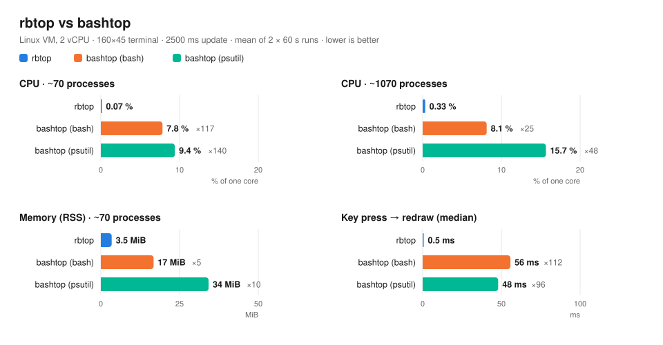

# rbtop – bashtop in Rust

**English** · [Deutsch](README.de.md)

A rewrite of [bashtop](https://github.com/aristocratos/bashtop) (aristocratos) in Rust:
same layout, **same key bindings**, same config and theme format, at a fraction of the
CPU cost. On top of that come the feasible feature requests from the original's GitHub
issues.

> [!WARNING]
> **Fully "vibe-coded".** All code, tests and this README were written by an AI
> (Claude, Anthropic). It was built and tested automatically in a sandbox and then on
> real systems, but **no human has reviewed the code line by line**. rbtop usually runs
> as root and can send signals to any process (`t`/`k`/`i`/`p`), so use it with
> appropriate care. Use at your own risk, see [LICENSE](LICENSE). Bug reports and
> reviews are welcome as issues.


Dependencies: only the `libc` crate. No TUI framework, no psutil, no external programs
per tick.

## Speed

Benchmark from 2026-11-28: rbtop 0.3.1 against bashtop 0.9.25, in both bashtop modes
(psutil = the default when psutil is installed; pure bash). Same conditions for all:
Linux VM with 2 vCPUs (x86_64), 160×45 terminal, 2500 ms update interval, two runs of
60 s each after 6 s of warm-up.

<picture>
  <source media="(prefers-color-scheme: dark)" srcset="docs/bench-en-dark.svg">
  
</picture>

**~70 processes (typical idle server):**

| | rbtop | bashtop bash | bashtop psutil |
|---|---|---|---|
| CPU (% of one core) | **0.07 %** | 7.8 % (×117) | 9.4 % (×140) |
| Memory (RSS) | **3.5 MiB** | 16.8 MiB (×5) | 34.2 MiB (×10) |
| Start to first frame | **0.11 s** | 1.24 s | 1.50 s |
| Key press to redraw (median / max) | **0.5 / 1.2 ms** | 56 / 76 ms | 48 / 77 ms |
| Helper processes started | **0/s** | 24/s | 22/s |
| Terminal output | **0.6 KiB/s** | 3.6 KiB/s | 4.1 KiB/s |

**~1070 processes:**

| | rbtop | bashtop bash | bashtop psutil |
|---|---|---|---|
| CPU (% of one core) | **0.33 %** | 8.1 % (×25) | 15.7 % (×48) |
| Memory (RSS) | **3.6 MiB** | 17.5 MiB | 37.0 MiB |
| Start to first frame | **0.27 s** | 1.17 s | 1.86 s |
| Key press to redraw (median / max) | **0.6 / 3.4 ms** | 38 / 135 ms | 38 / 274 ms |

What was measured:

- **CPU:** user plus system time of the whole process tree, including the short-lived
  helper processes bashtop starts (`ps`, `awk`, `grep` etc.).
- **Memory:** mean RSS of the process tree over the measurement window.
- **Helper processes:** new processes per second according to `/proc/stat`. The idle
  system was at 0.08/s, so rbtop's measured 0.06/s is noise.
- **Key press to redraw:** time from pressing Down to the first byte of the redraw,
  median and maximum of 15 key presses.
- **Start time:** from launch to the first complete frame. rbtop's number includes a
  deliberate 100 ms wait for the first CPU sample.

Under load bashtop's bash mode catches up, because it calls `ps` (written in C) once per
tick. rbtop's cost grows with every process, because the kernel has to generate each
`/proc/<pid>/stat` file individually. The psutil mode becomes the slowest with many
processes, because it walks all of them in Python.

The measurement can be repeated with [`bench/bench.py`](bench/bench.py); the raw data is
in [`bench/results-2026-11-28.jsonl`](bench/results-2026-11-28.jsonl).

```sh
python3 bench/bench.py rbtop 60 -- ./target/release/rbtop
python3 bench/bench.py bashtop 60 -- bash /path/to/bashtop
python3 bench/spawn_load.py 1000    # 1000 load processes (sleep 3600)
python3 bench/plot.py bench/results-2026-11-28.jsonl   # regenerate the chart
```

Why it is fast:

- **Diff renderer:** two cell buffers; only changed cells are written, with minimal
  cursor jumps and SGR changes, all in *one* `write()` with synchronized output
  (`?2026`).
- **Process hot path:** per tick and process only `/proc/<pid>/stat` is read, via
  `openat()` relative to an open `/proc` handle into a reused buffer. `cmdline`, UID and
  cgroup are read once per new PID (or after `exec`).
- **No polling:** `select()` sleeps until the next tick, the next second (clock) or the
  next key press; input is drawn immediately.
- **nvidia-smi**, if present, runs *once* permanently in streaming mode (`-lms`) instead
  of being started every tick.
- Release profile: LTO, `codegen-units=1`, `panic=abort`, stripped (about 750–850 KB).

With `rbtop -d` you see the collect/draw timings live at the bottom of the CPU box.

## Keys (as in the original)

| Key | Function |
|---|---|
| Esc, M, m | Main menu |
| F2, O, o | Options |
| F1, H, h | Help |
| Ctrl-C, Q, q | Quit |
| +, A, a / -, S, s | Update timer ±100 ms |
| Up / Down (Tab) | Select in the process list |
| Enter | Detailed view of the selected process (again: close) |
| Pg Up / Pg Down | Jump one page |
| Home / End | First / last page |
| Left / Right | Previous / next sort column |
| b, B / n, N | Previous / next network device |
| E, e | Toggle tree view |
| R, r | Reverse sort order |
| F, f | Enter a filter (Enter keeps it, Esc discards it) |
| C, c | Clear the filter |
| T, t | SIGTERM to the selected process |
| K, k | SIGKILL to the selected process |
| I, i | SIGINT to the selected process |

**New** (all of these keys were unused in the original):

| Key | Function |
|---|---|
| P, p | Pause/resume: SIGSTOP or SIGCONT, depending on the current state (#185) |
| Z, z | Reset download/upload totals (#63) |
| Ctrl-Z | Suspend rbtop to the shell (`fg` brings it back) |
| Mouse | Scroll and click in the process list (clicking the selected row = details), all `┤…├` buttons are clickable |
| Mouse on column header | Sort by that column, click again to reverse (for Cpu%, lazy/responsive is kept) |

The signal dialog additionally offers **[ +Tree ]**: sends the signal to the process and
all of its descendants (requested in #185, e.g. to pause Blender render jobs).

## Feature requests from the bashtop issues

| Issue | Request | Status in rbtop |
|---|---|---|
| #17 | iotop-like I/O values | ✅ read/write rates per disk (`/proc/diskstats`, **ZFS datasets via kstat**), per process in the detailed view (`/proc/<pid>/io`) |
| #26, #221 | GPU usage | ✅ AMD via sysfs (`gpu_busy_percent`, VRAM, temperature), NVIDIA via *one* long-running `nvidia-smi` |
| #48 | zenpower/k10temp temperatures | ✅ hwmon: coretemp (per core), k10temp (Tdie/Tctl), zenpower, cpu_thermal (ARM), acpitz/x86_pkg_temp as fallback |
| #63 | Reset network totals | ✅ key `z` |
| #73 | Graphs instead of meters for memory | ✅ option `mem_graphs` |
| #97 | Docker container info | ✅ container detected per process: Docker (incl. name), Podman, **Proxmox LXC (`CT 101 (hostname)`) and VMs (`VM 105 (name)`)**, libvirt, k8s; shown in the detailed view and searchable with the filter |
| #119 | zram info | ✅ zram devices with original → compressed size and ratio in the mem box |
| #185 | SIGSTOP/SIGCONT, also for child processes | ✅ key `p`, "+Tree" option |
| #199 | Battery level | ✅ in the CPU box title bar with charge/discharge symbol |
| – | Mouse support (added later in bpytop) | ✅ |
| #230 | More themes | ✅ loads all bashtop/bpytop/btop `.theme` files unchanged, the 9 original themes are bundled |
| #93 | Box with a custom command (tail -f …) | ❌ not implemented |
| #231 | Output to a spare VT | ❌ not needed: `openvt -s -- rbtop` |
| #235 | Windows | ❌ (Linux and macOS, see below) |

Not affected by original bug #234 (hang on `°C` in the sensors output), because rbtop
reads the hwmon values directly from `/sys` instead of parsing `sensors`.

## Build & installation

Linux or macOS, Rust ≥ 1.77:

```sh
cargo build --release          # → target/release/rbtop
sudo make install              # /usr/local/bin/rbtop + /usr/local/share/rbtop/themes
```

The GitHub Action builds ready-made binaries for every `v*` tag and attaches them to the
release:

- Linux: x86_64 and aarch64, each with glibc and statically linked with musl
- macOS: `aarch64-apple-darwin` (Apple Silicon), `x86_64-apple-darwin` (Intel) and
  `universal-apple-darwin` (both in one file)

## macOS

Since 0.2.0 rbtop also runs on macOS, since 0.3.0 with temperatures, disk I/O, GPU and
battery, with the same interface, the same keys and the same config. The data comes
from the native interfaces instead of `/proc`:

| Area | Source on macOS |
|---|---|
| CPU per core, load | Mach `host_processor_info`, `getloadavg` |
| Memory, swap | `host_statistics64` (same definitions as Activity Monitor), `vm.swapusage` |
| Processes | `libproc` (`proc_pidinfo`), command line via `sysctl KERN_PROCARGS2` |
| Process I/O (detailed view) | `proc_pid_rusage` |
| Network | `sysctl NET_RT_IFLIST2` (64-bit counters) |
| Disks | `getmntinfo`: `/` as `root` plus external volumes (on APFS the Data volume shares its container with `/` and would only repeat the same numbers) |
| Disk I/O | IOKit `IOBlockStorageDriver` statistics; APFS volumes show the rate of their physical SSD |
| CPU/GPU temperature | SMC (`Tp*`/`Te*` and `Tg*` on Apple Silicon, `TC0P` on Intel), IOHID sensors as fallback |
| GPU load | IOKit `IOAccelerator` "PerformanceStatistics" |
| Battery | IOKit `AppleSmartBattery` (MacBooks only) |

The CPU temperature is the average of the CPU sensors; per-core values don't exist on
the Mac. On Apple Silicon there is no VRAM figure, because GPU and CPU share memory.
Containers don't exist on macOS.

Notes:

- **`sudo rbtop`** shows CPU, memory and threads of all processes. Without root, macOS
  only reports name, user, state and start time for other users' processes; CPU and
  memory are 0 there.
- The **network device** at start is the one with the most traffic (usually `en0`);
  switch with `b`/`n` as usual or set it permanently with `net_device`.
- **Terminal:** rbtop uses 24-bit colour. With iTerm2, Ghostty, WezTerm or kitty
  everything is fine. If the colours look wrong in macOS Terminal.app, the installed
  version lacks truecolor support.
- Binaries downloaded with a **browser** are marked as "from the internet" by macOS; run
  `xattr -d com.apple.quarantine rbtop` once. Files downloaded with `curl` are not
  affected.

## Configuration

`~/.config/rbtop/rbtop.cfg`, same format as bashtop (`key="value"`). If it doesn't exist
yet, an existing `~/.config/bashtop/bashtop.cfg` is used. Everything can also be changed
in the options menu (`o`) and is saved when it is closed.

Original options: `color_theme`, `update_ms`, `proc_sorting`, `proc_reversed`,
`proc_tree`, `check_temp`, `draw_clock`, `background_update`, `custom_cpu_name`,
`proc_gradient`, `proc_per_core`, `disks_filter` (additionally with an `exclude=`
prefix), `hires_graphs`.

New: `mem_graphs`, `show_swap`, `show_battery`, `show_gpu`, `show_containers`,
`net_device`, `mouse`.

Themes are looked up in `~/.config/rbtop/themes`, the theme folders of
bashtop/bpytop/btop, `/usr/{local/,}share/{rbtop,bashtop,bpytop,btop}/themes`,
`/opt/homebrew/share/{rbtop,bpytop,btop}/themes` and `themes/` next to the binary.

## Tested / not tested

Tested in a real PTY: all keys, mouse, resize, 80×24 and the "Terminal size too small"
message, layout with 2–128 threads, filter, tree, detailed view, signals including
stop/continue, options, themes, saving the config. Unit tests for the key parser,
cgroup → container detection, theme parser, disk names, CPU model names, the macOS
command line, splitting program and arguments, and SMC decoding.

Checked on real systems:

- **Linux:** Debian 12 VM on Proxmox with ~1150 processes and Docker; container names
  (`docker:arr_sonarr`) are resolved correctly.
- **macOS:** Mac mini M4: CPU, memory, processes, network, disks, disk I/O, CPU
  temperature (SMC), GPU load and temperature. That a desktop Mac shows no battery is
  checked too.

**Not yet tested on real hardware:** Linux temperature sensors and GPU (AMD via sysfs,
NVIDIA via `nvidia-smi`), the battery display on laptops (Linux and MacBook), Intel Macs
and the Proxmox name resolution for CTs and VMs (the cgroup parser is covered by unit
tests; the names come from `/etc/pve/{lxc,qemu-server}/*.conf` and need root). Please
report deviations as an issue.

## Changelog

What changed in which version: [CHANGELOG.md](CHANGELOG.md) (also shown as release notes on the [releases page](https://github.com/gbomacfly/rbtop/releases)).

## License

Apache-2.0 like the original. Themes from the bashtop repository.
