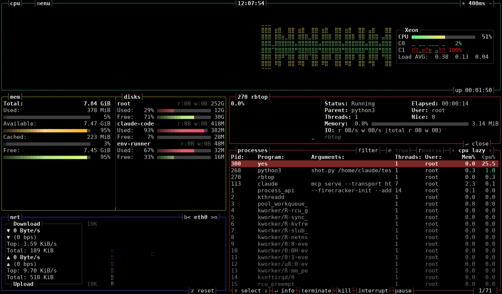

# rbtop – bashtop in Rust

Ein Nachbau von [bashtop](https://github.com/aristocratos/bashtop) (aristocratos) in Rust:
gleiches Layout, **gleiche Tastenbelegung**, gleiches Config- und Theme-Format, aber ein
Bruchteil der CPU-Last. Dazu kommen die umsetzbaren Feature-Requests aus den GitHub-Issues
des Originals.

> [!WARNING]
> **Komplett „vibe-gecoded“.** Der gesamte Code, die Tests und diese README wurden von
> einer KI (Claude, Anthropic) geschrieben. Gebaut und getestet wurde automatisiert in
> einer Sandbox und anschließend auf echten Systemen, aber **kein Mensch hat den Code
> Zeile für Zeile reviewt**. rbtop läuft meist als root und kann Signale an beliebige
> Prozesse schicken (`t`/`k`/`i`/`p`), also mit entsprechender Vorsicht benutzen.
> Benutzung auf eigene Gefahr, siehe [LICENSE](LICENSE). Bugs und Reviews sind als Issue
> willkommen.



Abhängigkeiten: nur das `libc`-Crate. Kein TUI-Framework, kein psutil, keine
externen Programme pro Tick.

## Speed

Gemessen in einer 2-Kern-VM, 160×45-Terminal, gleiche Bedingungen, CPU-Zeit inkl. Kindprozesse:

| Szenario | bashtop 0.9.25 | rbtop |
|---|---|---|
| ~70 Prozesse, 2500 ms Takt | 6,07 % eines Kerns | **0,05 %** |
| 1068 Prozesse, 2500 ms Takt | – | 0,37 % |
| 1068 Prozesse, 100 ms Takt | – | 7,8 % (≈ Kernel-Untergrenze für 1068× `/proc/<pid>/stat`) |
| Terminal-Ausgabe (70 Proz., 2500 ms) | 3,7 KiB/s | 0,5–0,7 KiB/s |

Warum es so schnell ist:

- **Diff-Renderer:** zwei Zellpuffer; geschrieben werden nur geänderte Zellen, mit
  minimalen Cursor-Sprüngen und SGR-Wechseln, alles in *einem* `write()` mit Synchronized
  Output (`?2026`).
- **Prozess-Hot-Path:** pro Tick wird pro Prozess nur `/proc/<pid>/stat` gelesen, via
  `openat()` relativ zu einem offenen `/proc`-Handle in einen wiederverwendeten Puffer.
  `cmdline`, UID und cgroup werden nur einmal pro neuer PID gelesen (bzw. nach `exec`).
- **Kein Polling:** `poll()` schläft bis zum nächsten Tick, zur nächsten Sekunde (Uhr)
  oder bis zum nächsten Tastendruck; Eingaben werden sofort gezeichnet.
- **nvidia-smi** läuft, wenn vorhanden, *einmal* dauerhaft im Streaming-Modus (`-lms`),
  statt jeden Tick neu gestartet zu werden.
- Release-Profil: LTO, `codegen-units=1`, `panic=abort`, gestrippt (~770 KB).

Mit `rbtop -d` siehst du die Zeiten für Sammeln/Zeichnen live in der Prozessbox.

## Tasten (wie im Original)

| Taste | Funktion |
|---|---|
| Esc, M, m | Hauptmenü |
| F2, O, o | Optionen |
| F1, H, h | Hilfe |
| Ctrl-C, Q, q | Beenden |
| +, A, a / -, S, s | Update-Timer ±100 ms |
| Up / Down (Tab) | Auswahl in der Prozessliste |
| Enter | Detailansicht des ausgewählten Prozesses (nochmal: schließen) |
| Pg Up / Pg Down | Eine Seite springen |
| Home / End | Erste / letzte Seite |
| Left / Right | Vorherige / nächste Sortierung |
| b, B / n, N | Vorheriges / nächstes Netzwerkgerät |
| E, e | Baumansicht umschalten |
| R, r | Sortierung umkehren |
| F, f | Filter eingeben (Enter übernimmt, Esc verwirft) |
| C, c | Filter löschen |
| T, t | SIGTERM an ausgewählten Prozess |
| K, k | SIGKILL an ausgewählten Prozess |
| I, i | SIGINT an ausgewählten Prozess |

**Neu** (alle Tasten waren im Original frei):

| Taste | Funktion |
|---|---|
| P, p | Pause/Fortsetzen: SIGSTOP bzw. SIGCONT, je nach aktuellem Status (#185) |
| Z, z | Download/Upload-Summen zurücksetzen (#63) |
| Ctrl-Z | rbtop in den Hintergrund (`fg` holt es zurück) |
| Maus | Scrollen und Klicken in der Prozessliste (Klick auf ausgewählte Zeile = Details), alle `┤…├`-Buttons sind klickbar |
| Maus auf Spaltenkopf | Nach dieser Spalte sortieren, erneuter Klick kehrt die Reihenfolge um (bei Cpu% bleibt lazy/responsive erhalten) |

Im Signal-Dialog gibt es zusätzlich **[ +Tree ]**: schickt das Signal an den Prozess und
alle seine Nachfahren (Wunsch aus #185, z. B. Blender-Renderjobs pausieren).

## Feature-Requests aus den bashtop-Issues

| Issue | Wunsch | Status in rbtop |
|---|---|---|
| #17 | iotop-artige I/O-Werte | ✅ Lese-/Schreibraten pro Disk (`/proc/diskstats`, **ZFS-Datasets über kstat**), pro Prozess in der Detailansicht (`/proc/<pid>/io`) |
| #26, #221 | GPU-Auslastung | ✅ AMD über sysfs (`gpu_busy_percent`, VRAM, Temperatur), NVIDIA über *ein* dauerlaufendes `nvidia-smi` |
| #48 | zenpower/k10temp-Temperaturen | ✅ hwmon: coretemp (pro Kern), k10temp (Tdie/Tctl), zenpower, cpu_thermal (ARM), acpitz/x86_pkg_temp als Fallback |
| #63 | Netzwerk-Summen zurücksetzen | ✅ Taste `z` |
| #73 | Graphen statt Balken für Speicher | ✅ Option `mem_graphs` |
| #97 | Docker-Container-Infos | ✅ Container pro Prozess erkannt: Docker (inkl. Name), Podman, **Proxmox-LXC (`CT 101 (hostname)`) und -VMs (`VM 105 (name)`)**, libvirt, k8s; in der Detailansicht und im Filter suchbar |
| #119 | zram-Infos | ✅ zram-Geräte mit Original → komprimiert und Ratio in der Mem-Box |
| #185 | SIGSTOP/SIGCONT, auch für Kindprozesse | ✅ Taste `p`, Option „+Tree“ |
| #199 | Akkustand | ✅ in der CPU-Box-Titelleiste mit Lade-/Entladesymbol |
| – | Maussteuerung (in bpytop nachgereicht) | ✅ |
| #230 | Weitere Themes | ✅ lädt alle bashtop/bpytop/btop-`.theme`-Dateien unverändert, 9 Original-Themes liegen bei |
| #93 | Box mit eigenem Kommando (tail -f …) | ❌ nicht umgesetzt |
| #231 | Ausgabe auf freie VT umleiten | ❌ nicht nötig: `openvt -s -- rbtop` |
| #235 | Windows | ❌ (Linux und macOS, siehe unten) |

Nicht betroffen von Original-Bug #234 (Hänger bei `°C` in der sensors-Ausgabe), weil
rbtop die hwmon-Werte direkt aus `/sys` liest statt `sensors` zu parsen.

## Build & Installation

Linux oder macOS, Rust ≥ 1.77:

```sh
cargo build --release          # → target/release/rbtop
sudo make install              # /usr/local/bin/rbtop + /usr/local/share/rbtop/themes
```

Fertige Binaries baut die GitHub-Action bei jedem Tag `v*` und hängt sie an das Release:

- Linux: x86_64 und aarch64, jeweils glibc und statisch mit musl
- macOS: `aarch64-apple-darwin` (Apple Silicon), `x86_64-apple-darwin` (Intel) und
  `universal-apple-darwin` (beides in einer Datei)

## macOS

Seit 0.2.0 läuft rbtop auch auf macOS, mit derselben Oberfläche, denselben Tasten und
derselben Config. Die Daten kommen aus den nativen Schnittstellen statt aus `/proc`:

| Bereich | Quelle unter macOS |
|---|---|
| CPU pro Kern, Load | Mach `host_processor_info`, `getloadavg` |
| Speicher, Swap | `host_statistics64` (Werte wie in der Aktivitätsanzeige), `vm.swapusage` |
| Prozesse | `libproc` (`proc_pidinfo`), Kommandozeile über `sysctl KERN_PROCARGS2` |
| Prozess-I/O (Detailansicht) | `proc_pid_rusage` |
| Netzwerk | `sysctl NET_RT_IFLIST2` (64-Bit-Zähler) |
| Disks | `getmntinfo`: `/` als `root` und externe Volumes (das Data-Volume teilt sich bei APFS den Container mit `/` und würde nur dieselben Zahlen wiederholen) |

**Noch nicht auf macOS** (geplant als zweiter Schritt über IOKit): Temperaturen,
Disk-I/O-Raten, Akku, GPU. Container gibt es unter macOS nicht.

Hinweise:

- **`sudo rbtop`** zeigt CPU, Speicher und Threads aller Prozesse. Ohne root liefert macOS
  für Prozesse anderer Benutzer nur Name, Benutzer, Status und Startzeit; dort stehen
  CPU und Speicher dann auf 0.
- Das **Netzwerkgerät** beim Start ist das mit dem meisten Traffic (meist `en0`);
  wechseln wie gewohnt mit `b`/`n` oder fest über `net_device`.
- **Terminal:** rbtop nutzt 24-Bit-Farben. Mit iTerm2, Ghostty, WezTerm oder kitty
  passt alles. Wenn die Farben im Terminal.app von macOS falsch aussehen, liegt das
  an fehlender Truecolor-Unterstützung der installierten Version.
- Per **Browser** geladene Binaries markiert macOS als „aus dem Internet“; dann einmal
  `xattr -d com.apple.quarantine rbtop`. Mit `curl` geladene sind nicht betroffen.

## Konfiguration

`~/.config/rbtop/rbtop.cfg`, Format wie bashtop (`key="value"`). Gibt es noch keine,
wird eine vorhandene `~/.config/bashtop/bashtop.cfg` übernommen. Alles ist auch im
Optionsmenü (`o`) änderbar und wird beim Schließen gespeichert.

Original-Optionen: `color_theme`, `update_ms`, `proc_sorting`, `proc_reversed`,
`proc_tree`, `check_temp`, `draw_clock`, `background_update`, `custom_cpu_name`,
`proc_gradient`, `proc_per_core`, `disks_filter` (zusätzlich mit `exclude=`-Präfix),
`hires_graphs`.

Neu: `mem_graphs`, `show_swap`, `show_battery`, `show_gpu`, `show_containers`,
`net_device`, `mouse`.

Themes werden gesucht in `~/.config/rbtop/themes`, den Theme-Ordnern von
bashtop/bpytop/btop, `/usr/{local/,}share/{rbtop,bashtop,bpytop,btop}/themes`,
`/opt/homebrew/share/{rbtop,bpytop,btop}/themes` und `themes/` neben der Binary.

## Getestet / nicht getestet

Getestet in einem echten PTY: alle Tasten, Maus, Resize, 80×24 und die
„Terminal size too small“-Meldung, Layout mit 2–128 Threads, Filter, Baum,
Detailansicht, Signale inkl. Stop/Continue, Optionen, Themes, Config-Speicherung.
Unit-Tests für Tastatur-Parser, cgroup→Container-Erkennung, Theme-Parser,
Disk-Namen, CPU-Modellnamen und den macOS-Kommandozeilen-Parser.

**macOS:** Der Code wurde in der (Linux-)Build-Umgebung gegen die echten macOS-Bindings
für `aarch64-apple-darwin` und `x86_64-apple-darwin` kompiliert und mit Clippy geprüft,
lief dort aber nicht. Der erste echte Lauf passiert in der CI auf `macos-latest` und
auf deinem Mac; Abweichungen bitte als Issue melden.

Mangels Hardware in der Build-Umgebung **nicht live getestet**: GPU-Anzeige, Akku,
Temperatursensoren und die Docker/Proxmox-Namensauflösung (der cgroup-Parser ist
per Unit-Test abgedeckt, die Namen kommen aus `/var/lib/docker/containers/*/config.v2.json`
bzw. `/etc/pve/{lxc,qemu-server}/*.conf` und brauchen root).

## Lizenz

Apache-2.0 wie das Original. Themes aus dem bashtop-Repository.
